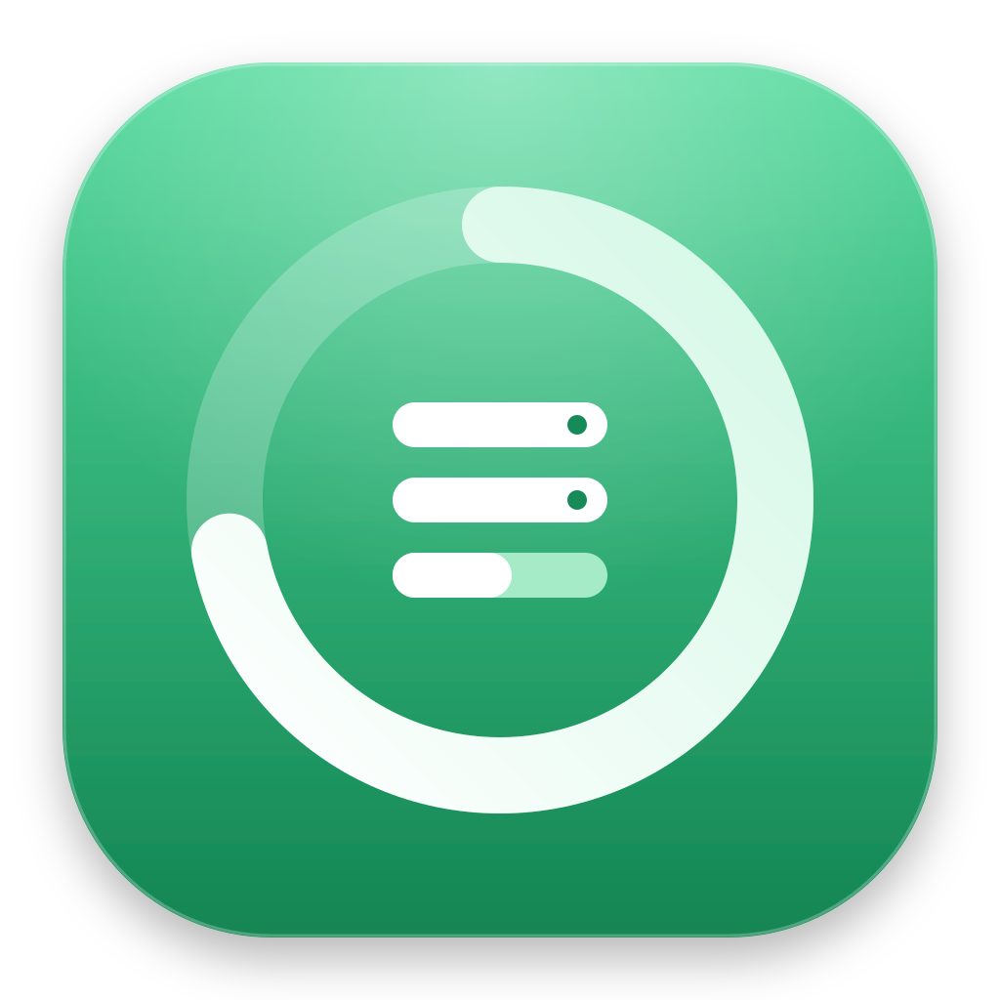

<p align="center"></p>

<h1 align="center">Storage</h1>
<p align="center"><b>The disk-space dashboard that tells you what is safe to delete — and why.</b><br>
Private, local, open source. A native Mac app, a menu-bar item and a widget.</p>

---

Macs fill up quietly: `node_modules` in forgotten projects, Gradle and Cargo caches, simulators, installers you ran once. Most tools show you a big colourful map and leave the hard part — *"can I delete this?"* — to you. **Storage answers that question, turns the answers into a short checklist, and never deletes anything without asking.**

## What makes Storage different

| | Typical disk visualizer | Typical "cleaner" app | **Storage** |
|---|---|---|---|
| Shows where space goes | ✅ | partly | ✅ treemap, donut, trends |
| Knows what is **regenerable** (`node_modules`, `.next`, Rust `target`, venvs, Pods, tool caches) | ❌ | generic "junk" | ✅ per project, aged by real activity (git / manifest), with *how to get it back* |
| Tells you **why** and **how to undo** | ❌ | rarely | ✅ every suggestion, *Safe* vs *Review* |
| Turns findings into **small tasks** | ❌ | one big "Clean" button | ✅ checklist ordered by payoff and effort; select → confirm → run |
| Handles tool-specific jobs (conda, Homebrew, Trash) | ❌ | partly | ✅ allow-listed commands, reports space actually freed |
| Data leaves your Mac | varies | often | **never by default**; optional opt-in check-in shows its exact payload |
| Accounts / subscription | varies | usually | none · MIT license |
| Weight | varies | large | ~1 MB native app, **zero dependencies** |
| Native extras | – | – | menu-bar free-space readout, desktop widget, verified in-app updates |
| Auditable | closed | closed | **open source** — read exactly what it deletes |

(The first two columns describe categories of tools in general, not any specific product.)

## Features
- **Overview** – free-space ring, category donut, 7-day trend, what can be reclaimed, biggest folders, alerts when the disk is ≥ 80 % full or free space drops fast.
- **Checklist** – "Clear Gradle caches · +2.8 GB", "Run Homebrew cleanup", "Decide on *My first video.mov*"… Tick to select, **Run selected**, confirm. Progress and space freed today are tracked. → [docs/checklist.md](docs/checklist.md)
- **Cleanup** – every suggestion with its reason and restore hint; safe items are deleted directly, review items go to the Trash through Finder (so *Put Back* works).
- **Explorer** – treemap + list for any folder; reveal in Finder or move to Trash.
- **History** – free space over time and a log of everything cleaned.
- **Light / Dark / Auto**, a launch splash and a live **scan animation** with the folder being read.
- **Mac app + widget** – window, menu-bar readout, Dock badge when an update is out. → [docs/mac-app.md](docs/mac-app.md)
- **Updates** – "Restart to update": downloads the release, verifies SHA-256, bundle id, version and code signature, swaps itself and relaunches.

## Install
```bash
git clone https://github.com/vimalsri318/storage-dashboard && cd storage-dashboard
./macos/build.sh --install          # builds ~/Applications/Storage.app (needs Command Line Tools + Node.js)
# or just run the dashboard in your browser:
node server.js --open               # http://127.0.0.1:4747
```
Prebuilt zips (with SHA-256) are attached to each [GitHub release](../../releases). They are ad-hoc signed: the first time, right-click → **Open**.

## Safety model
Local-only server (`127.0.0.1`, Host-header check) · per-run token on every write · only scanner-produced items can be cleaned · everything must live inside `$HOME` and avoid protected places (Keychains, iCloud, `.ssh`, Photos libraries…) · Trash via Finder · fixed command allow-list · update downloads verified end to end. → [docs/architecture.md](docs/architecture.md), [SECURITY.md](SECURITY.md)

## Privacy
Nothing is sent by default. Update checks only ask GitHub for the latest release. If a build ships with a fleet server, a first-run prompt asks whether to share an anonymous check-in; the app shows the **exact** JSON. → [PRIVACY.md](PRIVACY.md)

## Shipping it to other people? (Fleet Admin)
An optional zero-dependency admin server shows **how many devices use Storage, which version each runs, who has not updated**, lets you stage rollouts, push in-app notices ("Please update — restart to install") and keeps an audit log. A tag push builds, releases and notifies it automatically. → [admin/README.md](admin/README.md), [docs/fleet.md](docs/fleet.md)

## Development
```bash
npm test                  # 20 tests, no dependencies
PORT=4748 STORAGE_DATA=/tmp/sd node server.js
./macos/build.sh          # app + widget
```
Layout: `server.js` (scanner + API) · `public/` (UI) · `lib/` (updater) · `macos/` (app, widget) · `admin/` (fleet server) · `docs/`. See [CONTRIBUTING.md](CONTRIBUTING.md).

## Roadmap / known limits
- Developer ID signing + notarization (needs an Apple account) so strangers can open it without a warning.
- Intel build; localisation.
- Fleet Admin: two-factor login, multiple roles, signed update manifests.
- Docker pruning when Docker is running; more tool rules (Flutter, Unity, JetBrains…). PRs welcome.

## License
[MIT](LICENSE) © Storage Dashboard contributors.
